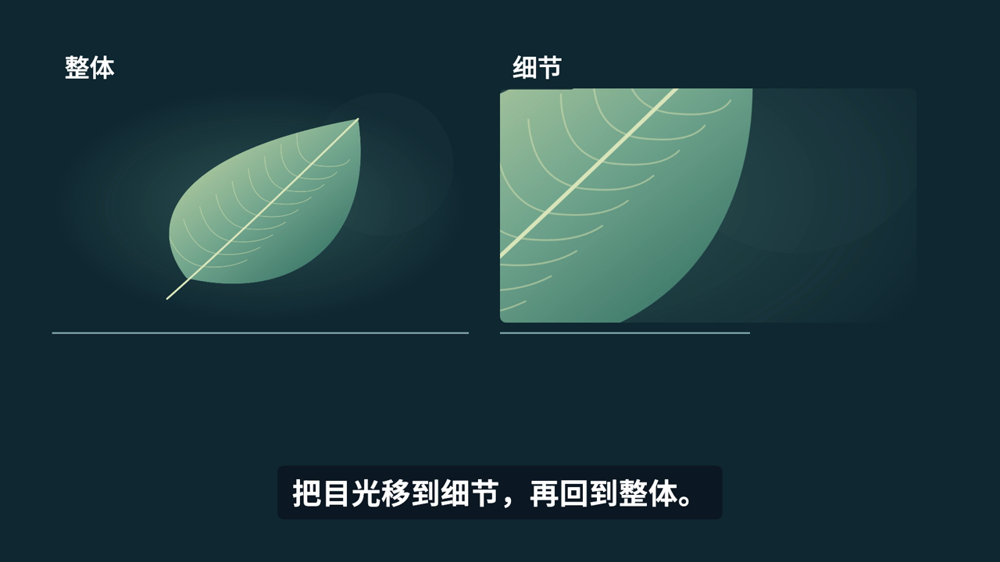

# Intro Video Starter · 介绍视频制作模板

用自己的素材与脚本制作介绍视频。本工程提供 Remotion 动效组件、项目骨架、18 秒完整示例和本地 MP4 导出命令。示例是程序绘制的叶片插画与合成配乐，不含真人、博物馆素材或外部音乐；它演示工作流程，不提供自动写稿、自动识别展品或一键成片服务。

基础示例不需要 Codex、API Key 或付费 AI 调用。AI 辅助制作的说明见 [docs/AI.md](docs/AI.md)。Remotion 等依赖仍适用各自条款，见 [THIRD_PARTY.md](THIRD_PARTY.md)。



## 先跑通示例

首版验证目标是 macOS / Apple Silicon，1920×1080、30 fps。需要 Node.js 24.x 或 26.x、npm、FFmpeg / ffprobe；本次实际版本与测试范围见 [验证记录](docs/VALIDATION.md)。Windows、Linux、其他画幅尚未完成端到端验证。

1. 下载并解压这个仓库，或用 Git 克隆，然后在终端进入仓库根目录。
2. 安装缺少的依赖。已有满足版本的工具可跳过；使用 Homebrew 的 macOS 用户可执行：

   ```sh
   brew install node@24 ffmpeg
   export PATH="$(brew --prefix node@24)/bin:$PATH"
   ```

3. 在仓库根目录执行：

   ```sh
   npm ci
   npm run doctor
   npm run check
   npm start
   ```

`npm start` 会准备示例素材并启动 Studio；打开终端显示的本地地址，选择 `IntroDemo`。首次预览或渲染可能联网下载 Remotion 的 Chrome Headless Shell。依赖安装和浏览器下载需要网络；示例的图片、字体、音频均为本地文件。

导出与检查：

```sh
npm run render
npm run verify -- out/demo.mp4 --expected-duration 18
```

预期产物：`out/demo.mp4`，18 秒、1920×1080、30 fps，H.264 视频和 AAC 双声道音频。文件已存在时拒绝覆盖；另存新版本：

```sh
npm run render -- --out out/demo-v2.mp4
```

建议始终导出到 `out/`。`--out` 也接受自选路径，但不要写到 `public/` 或项目 `assets/`，否则下次打包时会把成片也当作输入资产。

自动检查覆盖编码、尺寸、时长和完整解码。首次成片及重大修改仍需完整观看、试听输出；已验收版本的细小调整按[修改流程](docs/WORKFLOW.md#已验收版本的细小调整)执行。通过检查不代表内容正确、字幕同步或审美满意。

## 改一句话，换一张图

- 编辑 [src/demo-content.json](src/demo-content.json) 的 `title` 或 `comparisonCaption`，保存后预览更新。
- 把自己的 **1920×1080** 图片放到 `public/private/my-image.png`，将 `overallImage`、`detailImage` 改成 `private/my-image.png`。该目录默认被 Git 忽略。
- 在 [src/Demo.tsx](src/Demo.tsx) 调整实际裁切框、观察框和切点；整体／细节矩形须按新图片测量，不能假定旧坐标仍准确。
- 使用新输出文件名再次渲染。修改固定布局或出现长字幕后检查安全边距和遮挡。

`public/demo/` 由 `scripts/prepare-assets.mjs` 生成。内容相同时可重复运行；手工改动后会停止以保护文件。请把个人素材放在 `public/private/` 或独立项目，不用个人照片覆盖演示资产。

## 为自己的视频建项目

```sh
npm run new -- my-intro --title '新介绍视频' --dry-run
npm run new -- my-intro --title '新介绍视频'
```

项目位于 `projects/my-intro/`，包含简报、素材账、脚本、技术参数、独立入口和空白画面代码。**空白项目尚不能渲染**：先完成内容审核、填写 `project.json`，再实现 `Video.tsx`。技术参数不从演示片继承。原件放 `assets/source/`，派生文件放 `assets/derived/`；项目目录默认被 Git 忽略。

实现后，在仓库根目录执行：

```sh
npx --no-install remotion studio projects/my-intro/index.tsx --public-dir projects/my-intro/assets --webpack-poll=1000
npm run render -- --project my-intro --out out/my-intro-v1.mp4
npm run verify -- out/my-intro-v1.mp4
```

新项目共享根目录依赖和 `src/components/`，不要单独复制项目子目录后声称已带齐工程。字体已复制到项目自己的 `assets/fonts/`。

创建过程中若发生磁盘或权限错误，会保留已写文件并报告目录。检查这些文件、排除故障，再用新的 ID 建项目；脚本不自动删除半成品。当前新项目入口只接受 1920×1080，待决的画幅需先由你确认，其他画幅须适配组件与检查脚本。

## 目录与下一步

| 位置 | 用途 |
|---|---|
| [docs/WORKFLOW.md](docs/WORKFLOW.md) | 素材、主持词、样片、全片的制作与审核顺序 |
| [docs/COMPONENTS.md](docs/COMPONENTS.md) | 组件参数、时间单位、主持人裁切时钟和限制 |
| [docs/AI.md](docs/AI.md) | 可选技能来源与 AI 协作提示 |
| `src/`、`scripts/`、`templates/` | 源码、执行入口和新项目模板 |
| `public/` | 示例资产及有来源记录的中文字体 |
| [docs/VALIDATION.md](docs/VALIDATION.md) | 首次发布的实际验证与未验证范围 |

常见问题：缺少工具时运行 `npm run doctor`；找不到图片时核对 `staticFile()` 相对的是本次 `--public-dir`；首次浏览器下载失败时检查网络后重试；文件监听失败时保留 `--webpack-poll=1000`。遇到沙箱或执行权限阻拦，按使用工具的权限流程处理，不以关闭浏览器安全保护代替排查。

依赖锁定于 `package-lock.json`。保留当前 Zod 4.6.7 安全覆盖，Remotion 可能提示与其预期版本不一致；本次测试结果及限制见验证记录。不要在制作中的工程随意运行依赖升级。

本次使用 npm 11.17.0 的 `npm ci`，它识别 `package.json` 中的 `allowScripts`；本包将 esbuild 安装脚本设为不运行，使用 Rspack 渲染。安装后已实际完成示例导出；安装策略的验证范围限上述命令与版本，不作为旧版 npm 或其他安装方式的安全保证。

原创代码与示例生成器采用 [MIT License](LICENSE)。字体及依赖各自授权，不随本项目改为 MIT。此仓库由 Mao 与 AI 辅助整理；不包含账号、密钥、模型权重或私人项目素材。
